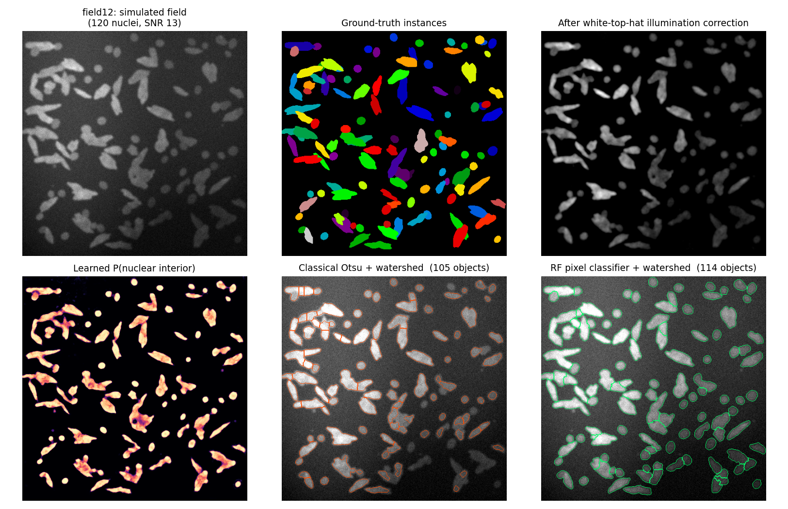
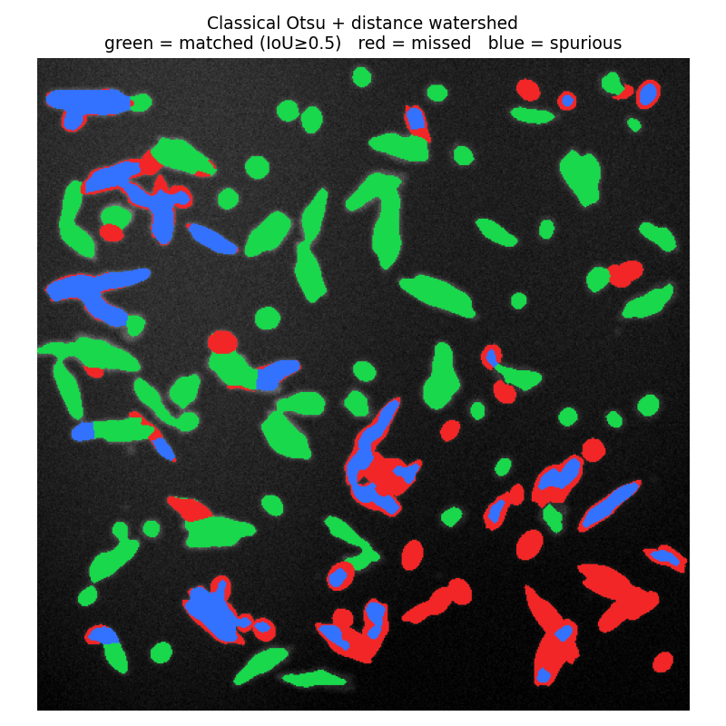
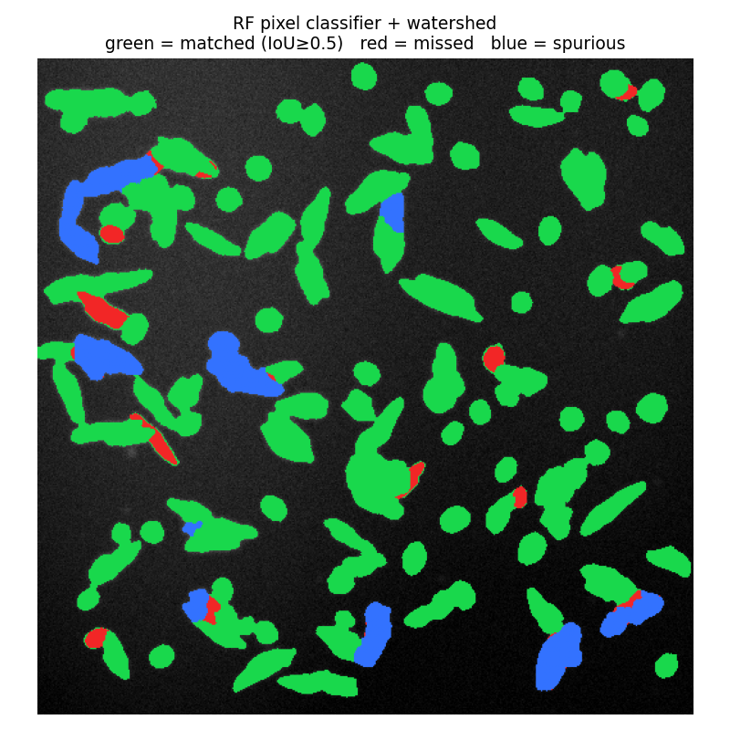
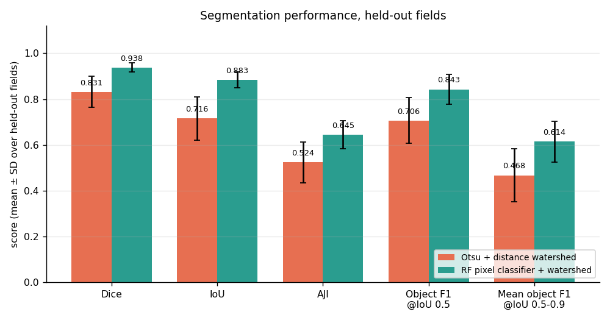
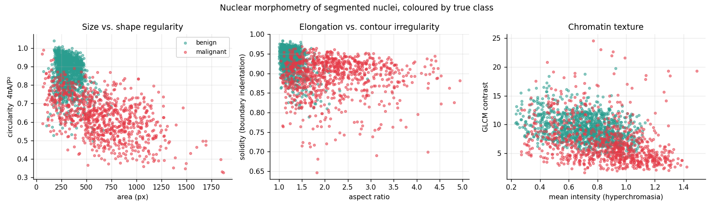
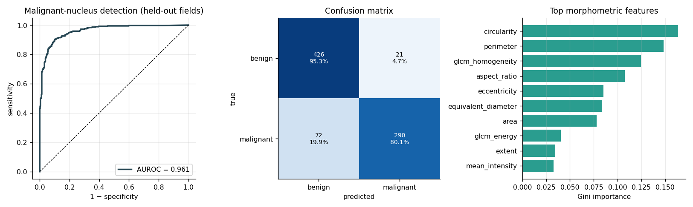

# Nuclei Segmentation & Nuclear Pleomorphism Grading

Quantitative analysis of nuclear-stain microscopy: **classical vs. machine-learned instance segmentation**, followed by morphometric feature extraction and automated **nuclear pleomorphism grading** — the component of the Nottingham (Bloom–Richardson) system that pathologists score most subjectively.

Images are generated with exact per-pixel instance ground truth, so segmentation quality is measured against a known answer rather than against noisy human annotation. No dataset download required.

---

## Results

Held-out fields (20 fields, 512×512, 2,100+ nuclei; 12 train / 8 test). Hyper-parameters for **both** methods were tuned on training fields only.

| Metric | Otsu + distance watershed | RF pixel classifier + watershed |
|---|---|---|
| Dice (semantic) | 0.831 | **0.938** |
| IoU (semantic) | 0.716 | **0.883** |
| **AJI** (instance) | 0.524 | **0.645** |
| Object F1 @ IoU 0.5 | 0.706 | **0.843** |
| Mean object F1 @ IoU 0.5–0.9 | 0.468 | **0.614** |
| Nucleus count error | −13.5 % | **+2.7 %** |

Nuclear pleomorphism classification (benign vs. malignant, per nucleus):

| Metric | Value |
|---|---|
| AUROC | **0.961** |
| Accuracy | 88.5 % |
| Malignant recall | 80.1 % |
| Field-level malignant fraction vs. truth | **r = 0.935**, mean abs. error 0.049 |

An AJI in the 0.52–0.65 range is consistent with published MoNuSeg results, which is the right sanity check for this metric.

### Figures

| | |
|---|---|
|  | |
| **Fig 1** — field, ground truth, background correction, learned interior probability, and both segmentations | |
|  |  |
| **Fig 2** — classical errors (green matched, red missed, blue spurious) | **Fig 3** — learned-method errors |
|  |  |
| **Fig 4** — metric comparison, mean ± SD | **Fig 5** — morphometric feature space by true class |
|  | |
| **Fig 6** — ROC, confusion matrix, feature importance | |

---

## Method

**Image generation.** Nuclei are radially-perturbed ellipses: benign nuclei are small, round and evenly textured; malignant nuclei are larger, elongated, lobulated and hyperchromatic with coarse chromatin. On top sit the imaging physics that actually break naive segmentation — touching and overlapping nuclei (41 % of nuclei touch a neighbour), chromatin texture, severe vignetting with sloped autofluorescence, point-spread-function blur, Poisson shot noise, Gaussian read noise, and autofluorescent debris that mimics small nuclei.

**Classical baseline.** Background subtraction → Gaussian denoise → Otsu → morphological cleanup → Euclidean distance transform → marker-controlled watershed. This is the CellProfiler/ImageJ workflow and the baseline any learned method must beat.

**Learned segmentation.** A random forest over a 24-channel multiscale filter bank (Gaussians, gradient magnitude, Laplacian-of-Gaussian, Hessian eigenvalues, difference-of-Gaussians at σ = 1, 2, 4, 8), predicting **three classes: background / nuclear interior / nuclear boundary**. Predicting boundaries explicitly is what separates touching nuclei — interior probability supplies clean markers, and the watershed floods the negative interior probability so ridges settle exactly where the model is confident a boundary lies. This is the 3-class U-Net formulation, using a random forest instead of a deep network: no GPU, no thousands of annotated images.

**Morphometry.** Per nucleus: size (area, equivalent diameter, perimeter), shape (eccentricity, solidity, circularity, aspect ratio, extent) and chromatin texture (intensity statistics plus GLCM contrast, homogeneity, energy, correlation) — the same properties a pathologist assesses, made reproducible.

---

## Methodological choices that matter

**Semantic metrics alone are not enough.** Dice is blind to under-segmentation: merge two touching nuclei into one blob and Dice stays at 1.0 while the nucleus count is wrong by half. AJI and object-level F1 are reported alongside, and a unit test asserts exactly this failure mode.

**Tuning happens on training fields.** Choosing a threshold by looking at test performance means the method is no longer being evaluated on unseen data. Both pipelines get the same tuning budget, and the chosen values are reported in `metrics.json`. "No background correction at all" is included in the sweep so the step has to earn its place empirically.

**One segmenter for both splits.** An early version trained the morphometry classifier on features from the classical segmenter and tested on features from the learned one. Segmenters differ systematically in the areas and boundary smoothness they produce, so this shifted the feature distribution between train and test — field-level correlation fell from 0.935 to 0.782 and mean absolute error rose five-fold, with the classifier calling almost everything malignant. Both splits now go through the winning segmenter.

**Two silent bugs, both caught by tests.** Worth reading `correct_illumination`'s docstring: the textbook **white top-hat** does *nothing* on shot-noise-limited fluorescence — Poisson noise puts near-zero pixels inside every structuring element, so the grey opening collapses to zero and the "corrected" image comes back byte-identical to the input. A test comparing background variance before and after is what caught it. The classic **rolling ball** then failed differently: skimage's `radius` measures the ball in intensity units as well as spatial ones, so on a float image scaled 0–1 the ball climbs over the nuclei and erases them — foreground recall dropped to 0.40. It works only with an explicit `ellipsoid_kernel`, at ~4× the runtime and slightly worse accuracy than the large-σ Gaussian background estimate now used.

---

## Quick start

```bash
git clone <your-repo-url>
cd 02-histopathology-nuclei-analysis
pip install -r requirements.txt

python -m src.pipeline                              # ~3 min, writes results/
python -m src.pipeline --n-fields 40 --size 768
pytest -q                                           # 22 unit tests
```

## Repository layout

```
src/synth.py        image generator: nuclear morphology, imaging physics, GT masks
src/classical.py    background correction, Otsu, morphology, distance watershed
src/ml_pixel.py     multiscale filter bank, 3-class RF, probability-driven watershed
src/metrics.py      Dice, IoU, object F1 across IoU thresholds, AJI
src/morphometry.py  shape/texture features, GT matching, pleomorphism scoring
src/pipeline.py     tuning, evaluation, figures, metrics export
tests/              22 unit tests
results/            figures, metrics.json, per-field CSVs, morphometry table
```

## Validated behaviour (test suite)

The tests assert *biology and metric semantics*, not just that the code runs: malignant nuclei must be measurably larger, less circular and more eccentric than benign ones; at least 15 % of nuclei must touch a neighbour (otherwise watershed is pointless and the benchmark is trivial); AJI and object F1 must punish merging two nuclei into one while Dice does not; a rasterised disk must have circularity ≈ 1 and eccentricity ≈ 0; an elongated ellipse must show aspect ratio > 2.5; learned probability maps must sum to 1 across classes; boundary-class pixels must never fall in the background.

## Limitations and honest caveats

- **Data are synthetic.** Real H&E and immunofluorescence carry staining variability, tissue architecture, overlapping cytoplasm, out-of-plane nuclei and artefacts this generator does not model. Performance on MoNuSeg or PanNuke would be lower.
- The benign/malignant distinction here is generated from explicit shape and texture parameters, so it is more separable than real nuclear atypia, where pathologist agreement itself is only moderate (κ ≈ 0.5). The AUROC of 0.96 should be read as "the morphometric pipeline recovers the signal that exists", not as a clinical validation.
- `src/synth.py` is the only dataset-specific module — everything downstream consumes `(image, instance_labels, class_dict)`, so swapping in real annotated data is a contained change.
- Single-channel intensity images only; no stain deconvolution for true H&E.

## References

1. Kumar N. et al. *A Dataset and a Technique for Generalized Nuclear Segmentation for Computational Pathology.* IEEE Trans. Med. Imaging 36(7):1550–1560, 2017. (AJI)
2. Ronneberger O., Fischer P., Brox T. *U-Net: Convolutional Networks for Biomedical Image Segmentation.* MICCAI, 2015.
3. Sommer C. et al. *ilastik: Interactive Learning and Segmentation Toolkit.* ISBI, 2011.
4. Sternberg S.R. *Biomedical Image Processing.* IEEE Computer 16(1):22–34, 1983. (rolling ball)
5. Elston C.W., Ellis I.O. *Pathological prognostic factors in breast cancer.* Histopathology 19(5):403–410, 1991. (Nottingham grading)

## License

MIT
